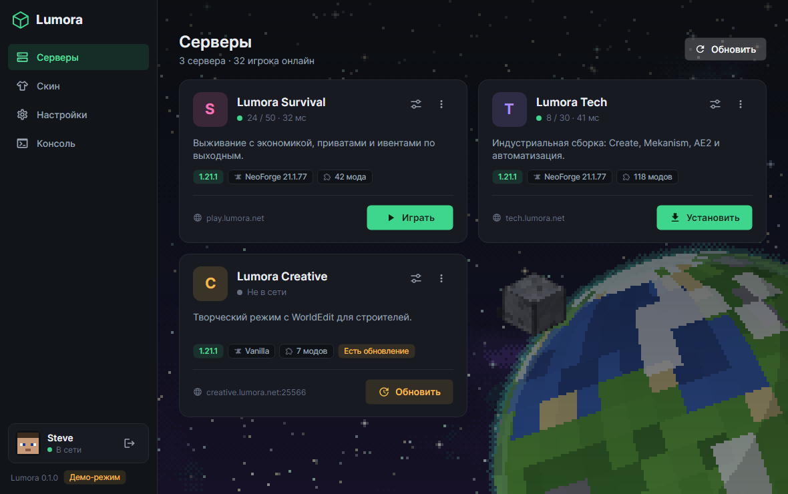
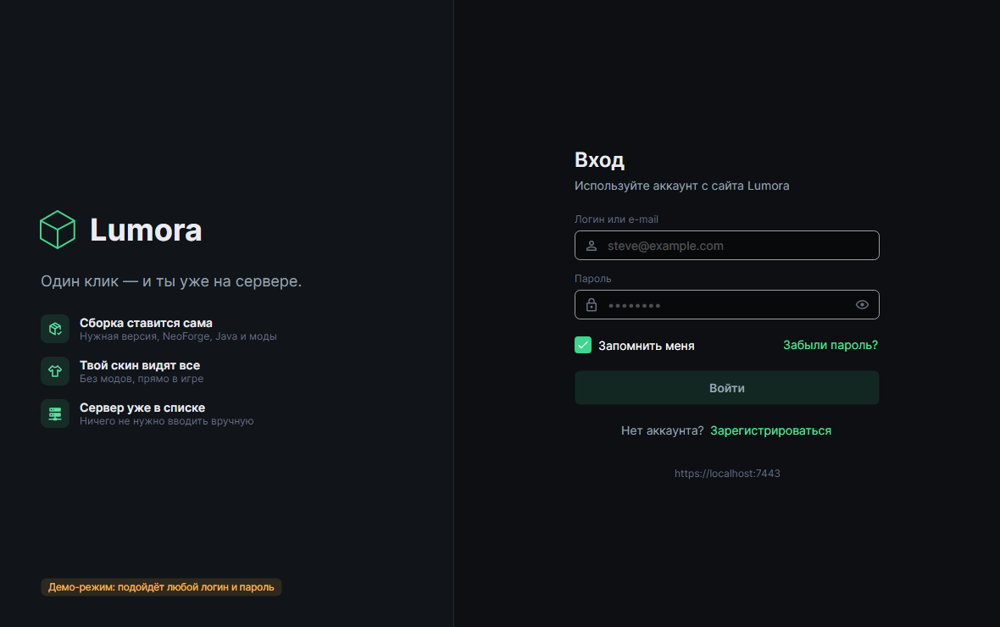
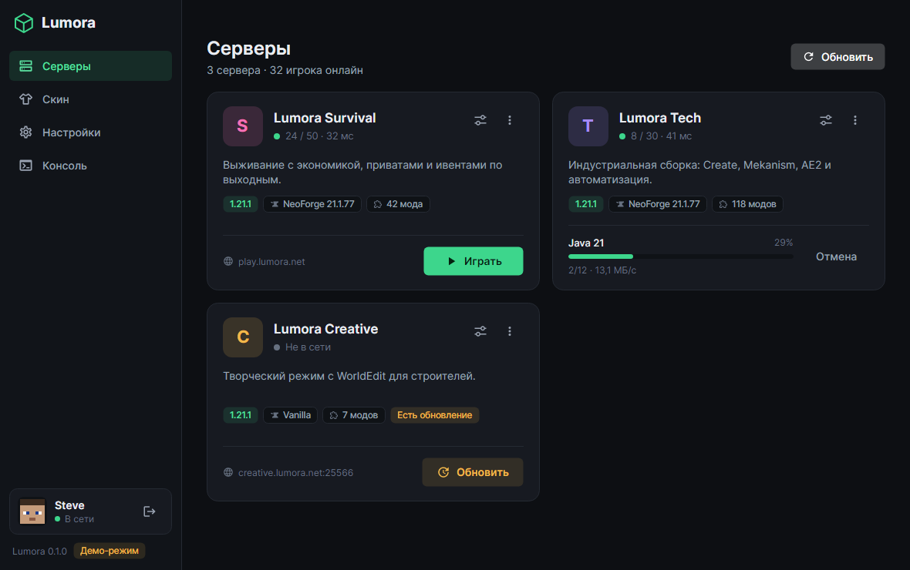
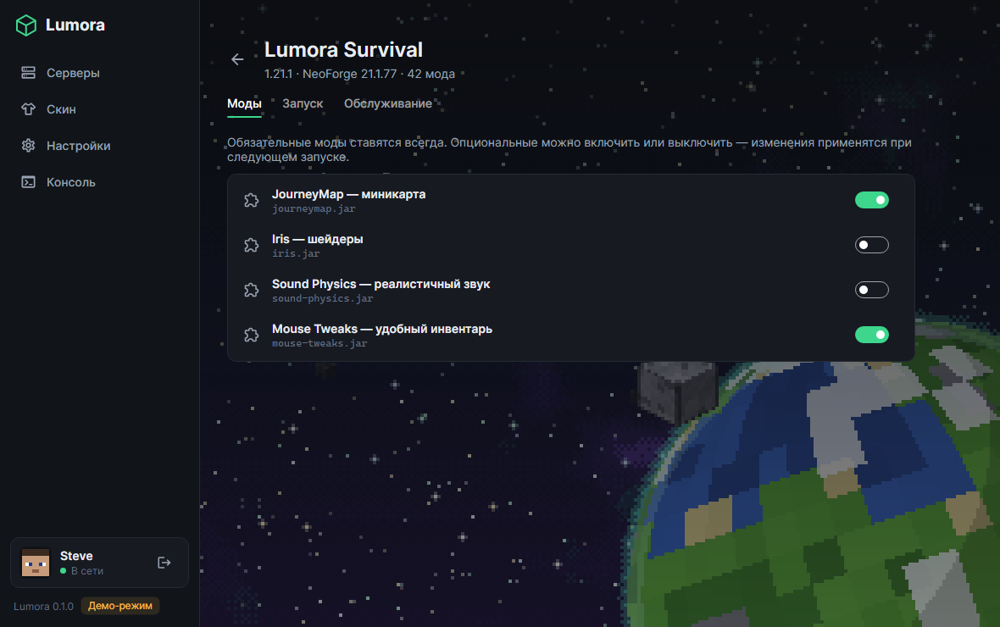
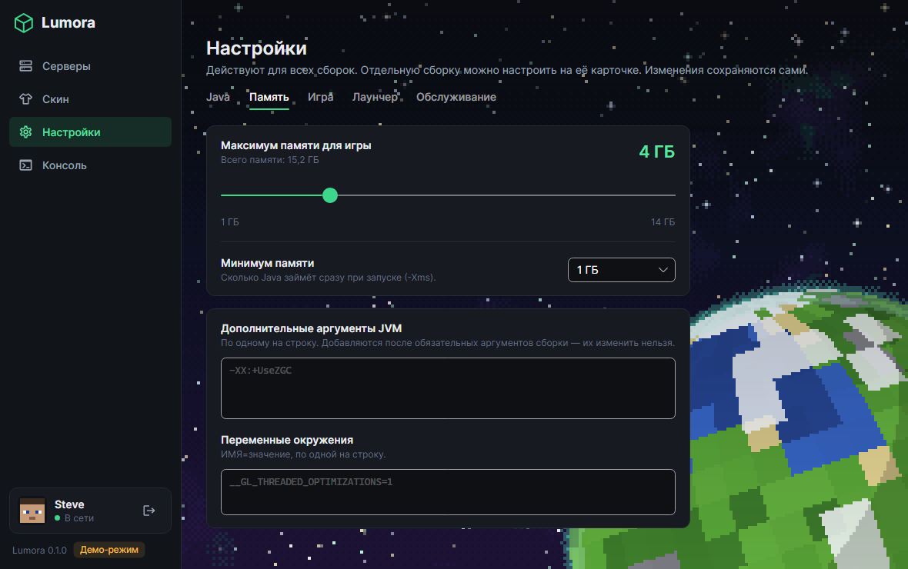
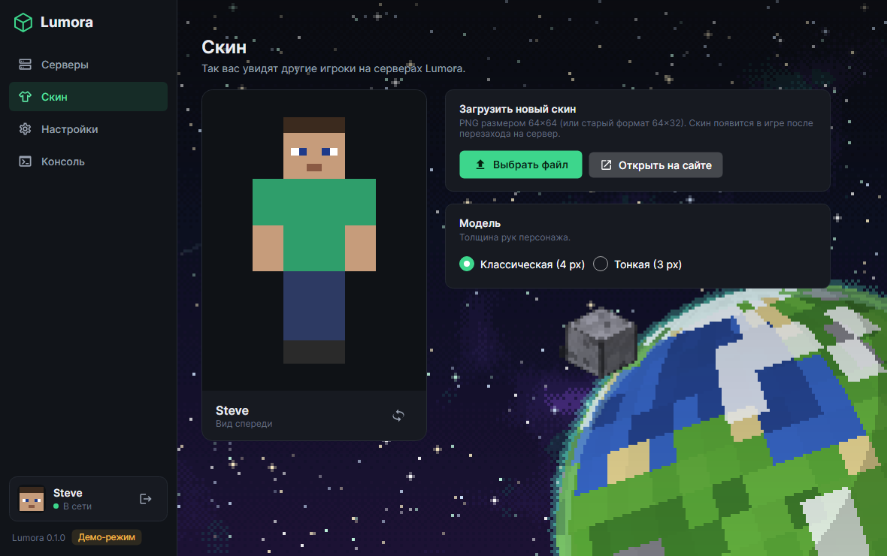
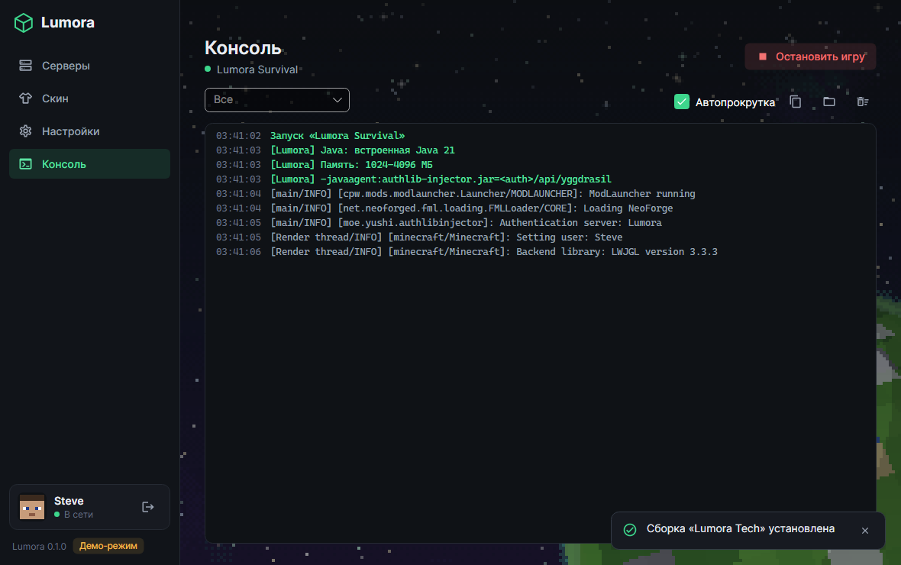

# lumora-launcher

Лаунчер Minecraft **Lumora** на Avalonia (Windows / Linux / macOS).

- Вход через аккаунт Lumora Auth.
- Сам ставит нужную версию Minecraft, Java и лоадер (NeoForge) для сборки сервера.
- Синхронизирует моды и конфиги сборки, сохраняя файлы игрока (ресурспаки, шейдеры, `options.txt`).
- Добавляет серверы сборки в список серверов игры (`servers.dat`), по желанию — автоподключение.
- Запускает игру с authlib-injector, поэтому скины с Lumora Auth видны в игре.
- Настройки в духе Prism Launcher: Java, память, JVM-аргументы, окно, опциональные моды —
  глобально и отдельно для каждой сборки.



| | |
|---|---|
|  |  |
|  |  |
|  |  |

## Как это работает

1. **Вход** — логин (ник или e-mail) и пароль с сайта Lumora Auth. «Запомнить меня» хранит только токен
   (в Windows — зашифрованным DPAPI), при запуске он обновляется.
2. **Серверы** — список с сервера авторизации, онлайн и пинг — настоящий Server List Ping.
3. **Установка** — [CmlLib.Core](https://github.com/CmlLib/CmlLib.Core) ставит Minecraft и Java от Mojang, затем NeoForge.
   Библиотеки, ассеты и Java общие для всех сборок (`<данные>/shared`), игровая папка у каждой сборки своя
   (`<данные>/instances/<id>`). Файлы сборки качаются по манифесту, проверяются по SHA-1 и кэшируются (`cache/files`).
4. **Синхронизация** при каждом запуске: `mods` — строго как в сборке (лишнее удаляется), `config` — файлы сборки
   обновляются, свои остаются, `options.txt` — только если его нет. Опциональные моды — по выбору игрока.
5. **servers.dat** — серверы сборки ставятся первыми, свои серверы игрока сохраняются.
6. **Запуск** с `-javaagent:authlib-injector.jar=<сервер>/api/yggdrasil` — вход на сервер и скины работают
   без модов. Вывод игры — во вкладке «Консоль».

Демо-режим с выдуманными данными (для работы над интерфейсом): `dotnet run --project src/Lumora.Launcher.App -- --demo`.

## Проверка без интерфейса

```bash
dotnet run --project tools/Lumora.Launcher.Smoke -- --server http://localhost:5080 --login <ник> --password <пароль>
```

Входит, ставит первую сборку из списка, запускает игру до главного меню и закрывает её; печатает этапы
установки и лог игры. Папка данных по умолчанию — во временной папке (`--data` чтобы сменить).

## Структура

| Проект | Назначение |
|---|---|
| `src/Lumora.Launcher.App` | UI (Avalonia, MVVM): экраны, тема, демо-сервисы |
| `src/Lumora.Launcher.Core` | Логика: клиент Lumora API, установка и запуск (CmlLib), синхронизация файлов, `servers.dat`, пинг серверов, поиск Java, настройки |
| `tests/Lumora.Launcher.Tests` | Тесты |
| `tools/Lumora.Launcher.Screenshots` | Рендер экранов в PNG без дисплея (для README и проверки вёрстки) |
| `tools/Lumora.Launcher.Smoke` | Сквозная проверка: вход → установка → запуск игры без интерфейса |

Скриншоты обновляются командой:

```bash
dotnet run --project tools/Lumora.Launcher.Screenshots -- docs/screenshots
```

Параметр запуска `--data <папка>` (или переменная `LUMORA_HOME`) задаёт папку с настройками — удобно для тестов.

## Сборка

Лаунчер использует `Lumora.Contracts` из репозитория `lumora-auth`, который должен лежать рядом:

```
Minecraft/
├─ lumora-auth/
└─ lumora-launcher/
```

```bash
dotnet build
dotnet test
dotnet run --project src/Lumora.Launcher.App
```

Другой путь к контрактам: `dotnet build -p:LumoraContractsProject=<путь>/Lumora.Contracts.csproj`.
